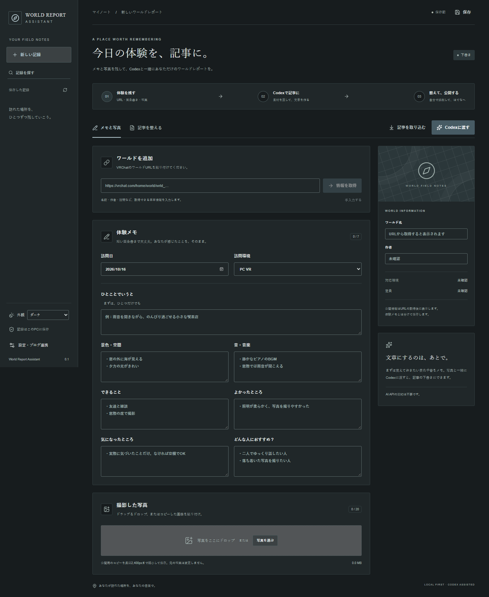

# World Report Assistant

VRChatのワールド情報、訪問メモ、撮影写真を残し、**このプロジェクトのCodexで記事を作って、添削して、はてなブログへ投稿する**Windows用の補助アプリです。WebView2 + Tauri / React / Rust / SQLite。PWAやブラウザ拡張ではありません。

投稿先は利用者が設定します。アプリは生成AI APIを呼びません。OpenAI APIキー、Ollama、サーバー契約は不要です。Codex自体の契約・利用上限は別途適用されます。

## テンプレートと記録形式

アプリを使わずに始められる [記入テンプレート](templates/world-report-v0.1.md) と、[なぜ項目を分けるか・入力例・保存項目の対応](docs/world-report-format.md) を公開しています。形式は試案 v0.1です。現時点でAI検索は実装していません。まずメモ・写真・記事をSQLiteに蓄積する道具です。



## インストール

[GitHub Releases](https://github.com/yuhi-neru/world-report-assistant/releases/latest) から `WorldReportAssistant-Setup-0.1.4-win-x64.exe` をダウンロードして実行します。管理者権限不要のユーザー単位インストールです。Windows 10/11 x64、WebView2 Runtimeが必要です。Runtimeがない場合はインストーラーがMicrosoftから導入します。Node.js / Rust / Pythonは利用者には不要です。

コード署名はしていません。ビルド検証済みでも、別PCでのSmartScreen表示やクリーンWindows環境での動作は未検証です。

## 記事を作る流れ

1. 「新しい記録」でVRChatのワールドURLを貼り、「情報を取得」。取得できない場合は設定でVRChatにログインするか、「手入力する」を選びます。
2. 訪問日・環境・箇条書きの感想を入力します。未記入の対応環境は「未確認」として扱います。
3. 写真を選択、ドロップ、または画像を貼り付けます。公開用コピーを長辺2,400px・JPEGに縮小してローカル保存します。元ファイルは変更しません。1記事20枚までです。
4. 「Codexに渡す」で素材フォルダと依頼文を作成します。コピーされた依頼文を**このプロジェクトのCodexチャット**に貼り付けます。
5. Codexが同じフォルダに `article.md` を作ったら「記事を取り込む」。本文とタイトルを自分で編集します。写真を削りたい場合は本文の `{{photo:ID}}` を削除します。
6. 「はてなへ投稿」で送信先・タイトル・文字数・使用写真数を確認し、下書き保存または公開します。既存記事は同じ記事を更新します。

アプリ内の編集内容は自動保存されます。終了時にも未保存内容を保存します。「保存済み」を確認してください。保存先のアクセス権限や容量不足などで失敗した場合は通知します。

Codexに「添削済みの記事を公開して」と依頼することもできます。Codexは以下のCLIで現在の版を読み取り、その版を指定して投稿します。素材ファイルの文章自体を公開許可とは扱いません。

## はてなの設定

「設定・ブログ連携」に、はてなID、ブログID、ブログAPIキー、フォトライフAPIキーを登録します。APIキー欄には投稿用メールアドレスをそのまま貼れます。共通キーだけを取り出してWindows DPAPIで暗号化して保存し、画面やログにキーを返しません。

- はてなIDは表示名ではなくログイン用のIDです。
- ブログIDは管理画面のAtomPub欄にあるもの。独自ドメインとは異なる場合があります。
- 共通APIキーは、はてなフォトライフ投稿用アドレスの `@` より前です。ブログ用アドレスを貼った場合はブログ配送用の `.～` 部分も除きます。
- **はてなブログの既定の編集モードをMarkdownに設定**し、アプリの確認欄をオンにしてください。APIの新規投稿はブログの既定記法の影響を受けます。
- 「保存して接続確認」は記事の読み取りだけです。写真の送信は投稿を確定したときに行います。

通常の記事投稿・下書き保存にProは不要です。写真の無料枠は月300MBです。Webhookや有料の固定ページ機能には依存しません。

## データとCodexとの受け渡し

ビルド元の開発プロジェクトがこのPCに存在する場合、保存先はそのプロジェクト内の `workspace/`。他のPCへ単独配布した場合は `%LOCALAPPDATA%\WorldReviewAssistant\workspace` に保存します。`WORLD_REVIEW_HOME` 環境変数で変更できます。

```text
workspace/
  data/reviews.sqlite3       ← ワールド・メモ・記事・写真・履歴・投稿状態
  private/settings.bin      ← Windowsユーザーに結びついた暗号化設定
  reviews/<レポートID>/
    review.json             ← 現在の保存内容の控え（DBが原本）
    edited.md               ← 現在の添削済み本文の控え
    input.json              ← Codex向けの入力情報と写真一覧
    request.md              ← 記事作成の依頼
    photos/<写真ID>.jpg     ← Codexが確認する公開用コピー
    article.md              ← Codexが作成する記事
  backups/                  ← SQLバックアップ
```

`review.json` を直接書き換えてもDBへは反映しません。Codexの記事は必ず取り込み操作を経由します。依頼後にメモ・写真・本文が変わった場合、古い記事の取り込みを止めます。再度「Codexに渡す」を実行してください。再依頼時は前の記事を `article.previous.*.md` に退避します。

SQLバックアップにはメモ・記事・画像と投稿履歴が含まれます。暗号化設定は含まれません。プロジェクトを移すときはアプリを閉じて `workspace` 全体をコピーしてください。秘密情報は元のWindowsユーザー以外では復号できないため、別のPCやユーザーでは再登録が必要です。

## Codexから使うCLI

開発用実行ファイルは `artifacts/world-review-assistant.exe`。CLIは画面を開かずに動作します。全コマンドの結果はJSONです。秘密情報を返すコマンドはありません。

```powershell
& .\artifacts\world-review-assistant.exe --cli list
& .\artifacts\world-review-assistant.exe --cli read REVIEW_ID
& .\artifacts\world-review-assistant.exe --cli prepare-codex REVIEW_ID
& .\artifacts\world-review-assistant.exe --cli import-article REVIEW_ID
& .\artifacts\world-review-assistant.exe --cli publish REVIEW_ID CURRENT_REVISION draft
& .\artifacts\world-review-assistant.exe --cli publish REVIEW_ID CURRENT_REVISION public
& .\artifacts\world-review-assistant.exe --cli reconcile REVIEW_ID
```

お知らせなど、訪問記録ではないMarkdown記事は `--cli import-document ABSOLUTE_MD_PATH` で新規取り込みできます。1行目を `# タイトル` とし、ワールドの基本情報は付けません。再実行は別の記事を作るため、返されたIDを控えてください。`--cli confirm-markdown true` はブログ側の設定を確認済みの場合だけ使います（ブログ自体の設定を変更するコマンドではありません）。

`read` で最新の `revision` と本文を確認し、その版を `publish` に指定します。版が違えば投稿しません。`status`, `check-blog`, `check-photo` は読み取り専用の状態・接続確認です。

## 投稿結果が分からないとき

投稿中の通信断やアプリ終了では、サーバー側で記事が作成済みの可能性があります。自動再送を止め、「投稿結果を確認」から編集URLまたはこの記事固有のURLを検索します。確認できない場合はブログ管理画面を見てください。記事が存在しないと人が確認した場合に限り、ローカル下書きへ戻せます。

写真のアップロード成功後に応答だけが失われた場合、フォトライフに未使用写真が残る可能性があります。写真を自動削除する処理はありません。アップロード済みURLが保存できた写真は再利用します。

## 開発・検証

```powershell
npm ci
npm run desktop
npm run build
npm run test:native
npm run test:browser
powershell -ExecutionPolicy Bypass -File tools/build-release.ps1
```

開発にはNode.js 24、Rust MSVC、Visual Studio C++ Build Tools、WebView2が必要です。ブラウザだけで画面を見る場合は `npm run dev`。保存や投稿はWindows版で利用できます。

ブラウザテストはMicrosoft Edgeを使用し、外部サービスは模擬応答です。Rustの投稿テストはローカルHTTPサーバーで、送信本文・写真参照・二重送信防止を検証します。実際のブログへの公開・写真アップロードは、設定と実際の素材を使った確認が必要です。

## 参照した公式仕様

- [はてなブログAtomPub](https://developer.hatena.ne.jp/ja/documents/blog/apis/atom/)
- [はてなフォトライフAtomAPI](https://developer.hatena.ne.jp/ja/documents/fotolife/apis/atom/)
- [WSSE・共通APIキー](https://developer.hatena.ne.jp/ja/documents/auth/apis/wsse/)
- [はてなフォトライフの容量と形式](https://help.hatenablog.com/entry/hatena/fotolife)
- [Microsoft WebView2](https://learn.microsoft.com/en-us/microsoft-edge/webview2/)

## ライセンス

MIT。配布物に含まれる依存ライブラリのライセンスは [THIRD_PARTY_NOTICES.txt](THIRD_PARTY_NOTICES.txt) に記載しています。

開発版は `tools/start-dev.ps1` で起動します。Windows PowerShell 5.1でも日本語を読み込めるよう、起動スクリプトはUTF-8 BOM付きです。既存の記事は `--cli edit-document ABSOLUTE_MD_PATH ARTICLE_ID REVISION` で同じIDのまま本文を更新できます。公開は別途 `publish` で行います。

## 画面テーマ

はてなブログの [Smoothテーマ](https://yuhineru.hatenablog.com/) に合わせ、薄いグレーの背景・白い紙面・明朝体タイトル・控えめな青みのグレーのアクセントで統一しています。記事プレビューも本文17px・行間1.85、見出し・引用・表を同じ雰囲気に揃えています。ブログのCSSは読み込まず、アプリ内のスタイルだけで表示します。埋め込みカードなどは投稿先で表示を確認してください。

左下の「外観」でダーク・ライト・Windowsに合わせるを切り替えられます。初期表示はダークです。選択はこのWindowsユーザーのアプリ内に保存し、再起動後も引き継ぎます。Windowsに合わせる場合は、OSの配色変更にも追従します。写真自体や投稿する記事の内容・ブログ側のテーマは変えません。
